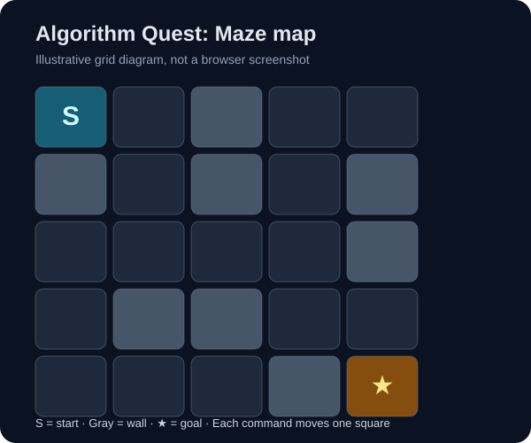

# Algorithm Quest: Python Maze Challenge

A small, browser-based Python lesson that introduces **sequencing**, **spatial reasoning**, and **debugging** through a five-by-five maze. This public repository is a software engineering and instructional design portfolio example.

> **Project status:** AQ-101 through AQ-105 are implemented. This README documents the lesson and its design rationale. A production deployment and an actual browser test of Pyodide are still pending. Do not treat automated CI as proof that the CDN runtime works end-to-end in a browser.



*Illustrative maze diagram (not a screenshot of the running app). A real application screenshot or short GIF will be captured during release QA.*

## Audience and prerequisites

- **Audience:** Beginners learning introductory Python, including learners who have never written movement commands before.
- **Prerequisites:** Basic understanding of using a web browser and typing into a text editor. Knowing what a Python function call looks like is helpful but not required.
- **Format:** One short, self-paced interactive lesson. No account, database, or API credentials are needed.
- **Learner objective:** Write and adjust a sequence of Python calls so a character moves from **S** to **★** without entering a wall or crossing the grid boundary.

## Try the lesson

1. Open the app, locate **S** (start), the dark wall squares, and **★** (goal).
2. Read the objective. Use the arrow buttons to experiment with possible routes.
3. Edit the starter code in **Your Python code** using `move_up()`, `move_down()`, `move_left()`, and `move_right()`.
4. Select **Run Python**. The browser downloads Pyodide on first run, which requires an internet connection.
5. Read the feedback. If the route ends early or hits a wall, inspect the **Previous step** and **Next step** timeline. Try the progressive hints if needed.
6. Adjust the code and run it again, or select **Reset maze**. Each Python run starts at **S**.

**Sample successful route:**

```python
move_right()
move_down()
move_down()
move_right()
move_right()
move_down()
move_right()
move_down()
```

The goal is reached on the eighth legal move. The learner can also write a Python `for` loop that calls the same movement functions.

## Teaching rationale

| Design choice | Intended learning effect | Observable evidence |
| --- | --- | --- |
| Small deterministic 5×5 maze | Minimize incidental complexity so learners can focus on ordering decisions | Learner can predict the next square before running code |
| Manual arrow controls before Python | Make the physical action concrete before expressing it as code | Learner can map a direction to a function call |
| Short starter program | Lower the difficulty of starting from an empty editor | Learner completes and modifies an existing sequence |
| Immediate success, blocked, and incomplete feedback | Make mistakes actionable rather than treating them as a generic failure | Learner adjusts the specific command causing a collision |
| Step-by-step trace | Make sequential execution observable | Learner can explain why a move succeeded or failed |
| Three staged hints | Support learning while preserving learner agency | Learner can revise a solution without being given the full program |
| Reset/retry | Encourage iteration and debugging | Learner can test a second approach without refreshing |

**Assessment criterion:** A correct solution reaches the star using valid movement commands. A successful run is shown in the UI. Completing the maze demonstrates *this specific sequencing task*, not mastery of broader algorithm design.

**Follow-up discussion:** Ask the learner to describe how moving one instruction earlier or later changes the outcome. Advanced learners can compare repeated calls with a loop and explain when a reusable pattern helps.

## Architecture

```text
Next.js/React lesson page
  ├── Manual arrows ────────> movePlayer() ────────> maze state and feedback
  └── Run Python
        └── Web Worker (public/workers/python-worker.js)
              └── pinned Pyodide CDN (first-run download)
                    └── Python calls move_up/down/left/right
                          └── ordered direction list
                                └── replayMoves() + getMovementTrace()
                                      └── position, feedback, and step review
```

- `src/lib/maze.mjs`: deterministic grid, boundaries, collision rules, and replay validation.
- `src/lib/lesson.mjs`: reviewable movement timeline, staged hints, and outcome messages.
- `src/components/maze-playground.tsx`: client-side lesson UI, editor, arrows, status, and control buttons.
- `public/workers/python-worker.js`: Python runtime loader and the small, learner-facing movement bridge.
- `tests/*.test.mjs`: automated tests for maze mechanics, command limits, step sequences, and lesson feedback.

The Python worker records movement calls in their original order. React replays that list using the same rules as the manual arrows. Python code is not run on the application server.

## Run locally

1. Install **Node.js 22** (see `.nvmrc`).
2. Clone the repository.
3. Run:

```bash
npm install
npm run dev
```

4. Open [http://localhost:3000](http://localhost:3000).

No environment variables or secrets are required; see `.env.example`. An internet connection is needed for npm installation and the first Pyodide runtime download.

## Quality checks

```bash
npm run lint
npm run typecheck
npm test
npm run build
```

GitHub Actions runs those checks for feature branch pushes and pull requests. A committed dependency lockfile is still pending, so CI currently uses `npm install` rather than `npm ci`. **Tests cover the logic but do not run real Python in a browser.**

### Browser QA checklist (required before public release)

- [ ] Load Pyodide in a browser with an internet connection.
- [ ] Run the sample route and reach the goal.
- [ ] Trigger a Python syntax error and verify readable feedback.
- [ ] Test an incomplete route, a wall collision, and reset.
- [ ] Verify step review and hints using a keyboard and mobile viewport.
- [ ] Try an infinite loop and verify timeout/recovery.
- [ ] Capture a real screenshot/GIF for the README once the running UI is verified.

## Constraints and security

The worker is disposable and enforces an 8,000-character input cap, 100-command output cap, and a timeout that terminates the worker. **A Web Worker and Pyodide are not a hardened security sandbox.** This exercise must not be given credentials, privileged APIs, or sensitive data. For production hardening, review dependencies and CDN delivery, add a restrictive Content Security Policy, and consider same-origin pinned runtime assets.

## Release and deployment

**Local-first:** run `npx playwright install chromium` once, then `npm run test:e2e` to start the app locally and test real Python in Chromium. See [the local QA and optional release runbook](docs/RELEASE.md). Vercel Hobby offers a free personal, non-commercial hosting option later; no deployment or release tag has been created.

## Planned releases

[AQ-001 epic](https://github.com/KevoCodo/algorithm-quest-python/issues/1) tracks the MVP. The remaining release work includes accessibility/mobile polish and deployment verification.

## License

The source is publicly visible. No open-source reuse license has been granted.
